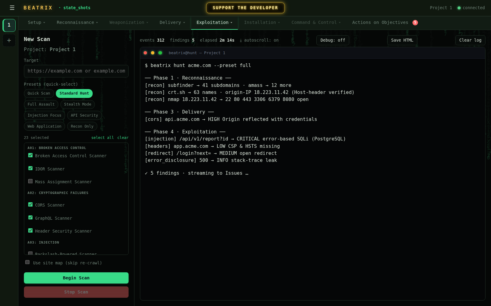
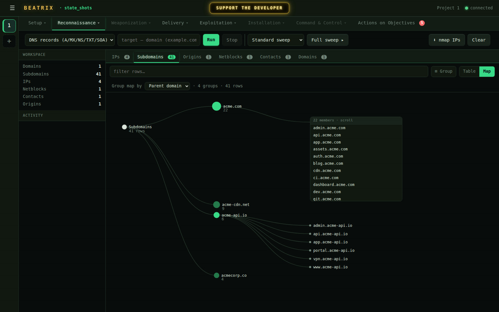
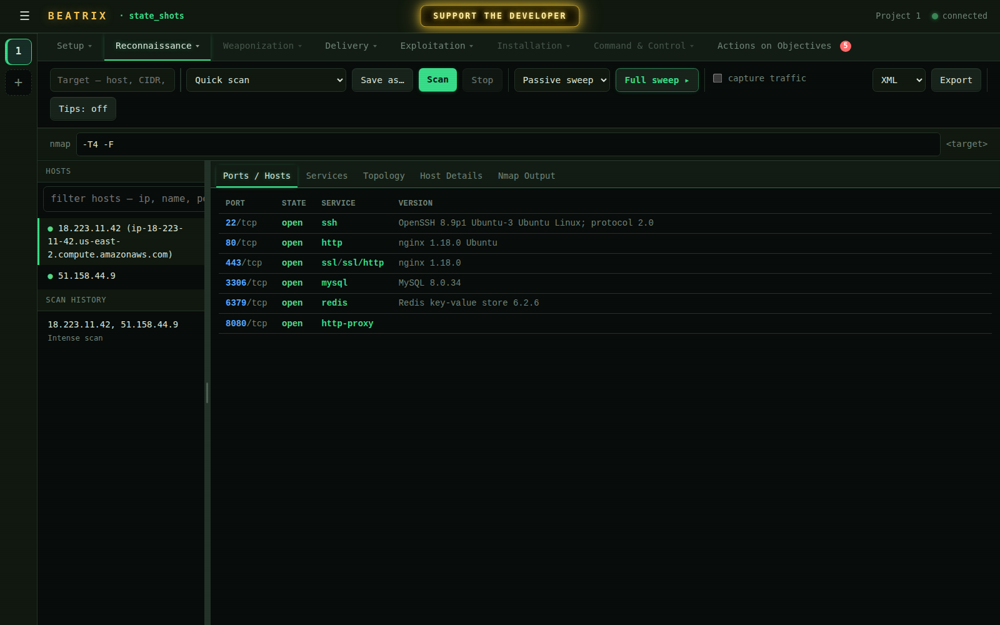
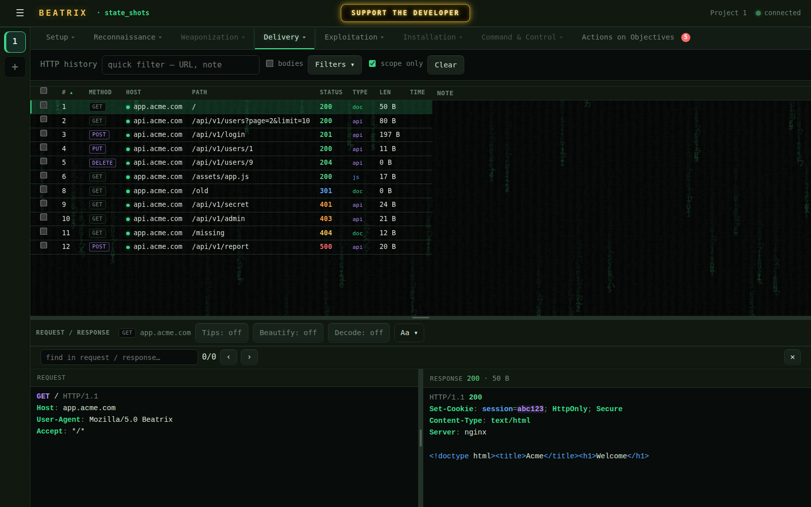
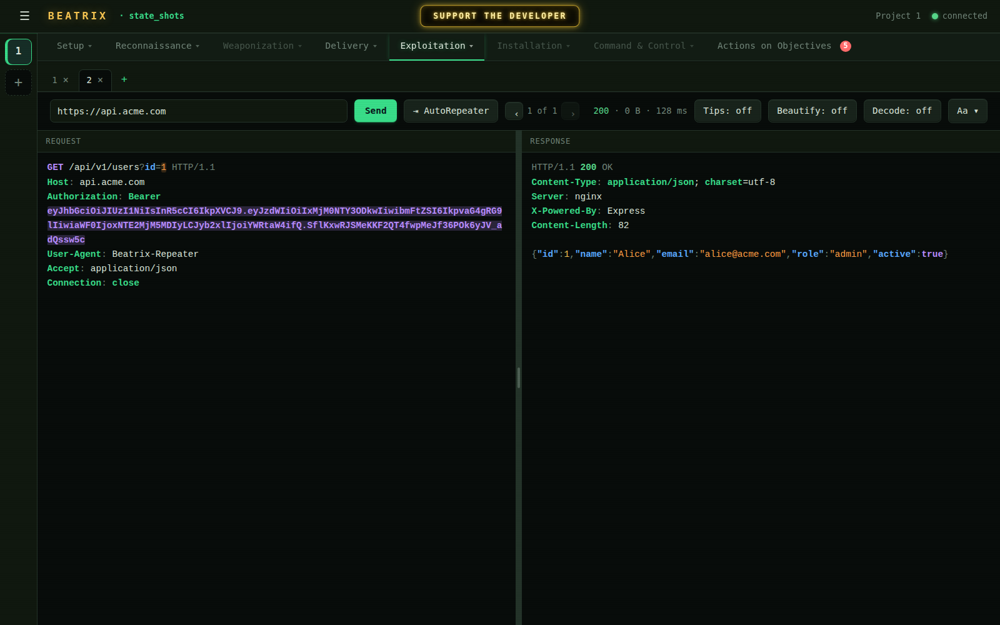
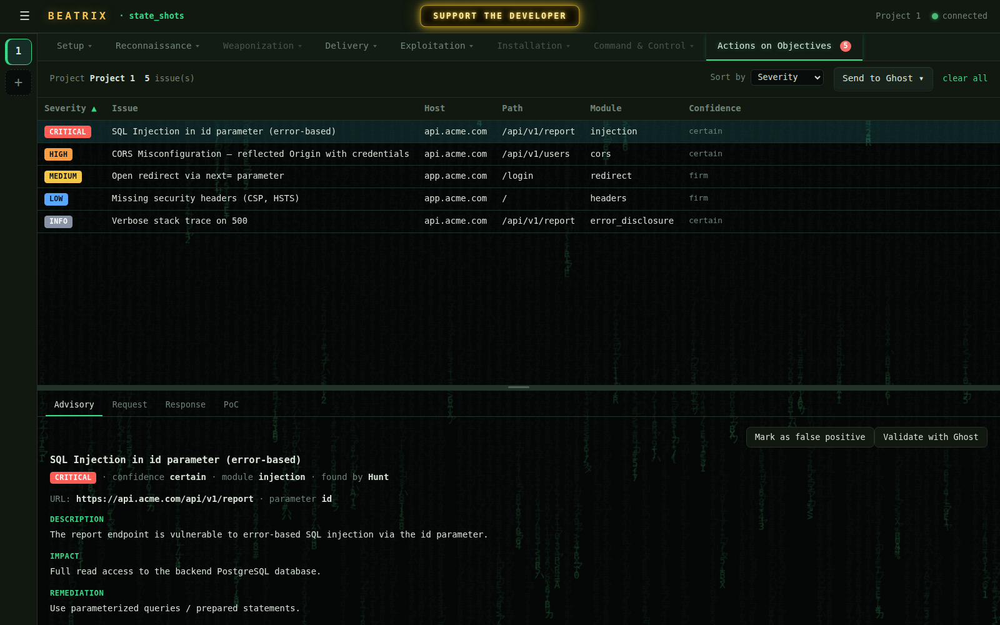

<p align="center">
  
</p>

<p align="center"><em>"Revenge is a dish best served with a working PoC."</em></p>

<p align="center">
  
  
  
  
  
</p>

<p align="center">
  A local, free <b>master pentesting super-suite</b> — the entire bug-bounty workflow in one web GUI,
  with a headless CLI underneath. It runs entirely on <code>127.0.0.1</code>; nothing leaves your machine.
</p>

---

## The Suite

One command opens a local web workbench — your whole hunt in the browser, organized along the cyber kill
chain. No cloud, no account, no telemetry:

```bash
beatrix-suite
```

<p align="center"></p>

Most tools solve one slice of the job. Beatrix runs the **whole engagement** — reconnaissance, network and
web scanning, a byte-faithful **Repeater** and an automated **fuzzer**, an autonomous **AI pentester**, and
a triageable **Issues** board — behind a single local command. Pick a preset, tick the scanner modules you
want (grouped by OWASP category), hit **Begin Scan**, and watch events and findings stream into a live
terminal. Prefer the terminal? The same toolkit runs fully headless from the CLI.

**The workspaces**, laid out by kill-chain stage:

- **Setup** — projects, target **Scope** (enforced end-to-end), and one-drop **Auth** (HAR / cookie / token / IDOR slots)
- **Reconnaissance** — **OSINT** (keyless asset discovery + a live entity map), **Network** (an nmap/Zenmap workbench), **Passive Scan**, **Site map**, and a **Packets** lab
- **Weaponization** — **Active Scan**, the hunt control panel above
- **Delivery** — an embedded **Browser** and full **HTTP history**
- **Exploitation** — **Ghost** (autonomous AI pentester), **Nuclei**, **Repeater**, **AutoRepeater**, and **Metasploit**
- **Actions on Objectives** — the **Issues** board

### OSINT — map your target's whole external surface
Keyless subdomain, DNS, certificate-transparency, passive-DNS, WHOIS/RDAP, and origin-IP discovery, with a
one-button resumable **Full Sweep** — rendered as a pannable entity map you can drag, expand, and pivot from.

<p align="center"></p>

### Network — an nmap workbench in the browser
A Zenmap-style front end: an à-la-carte profile catalog, a resumable Full Sweep, and a deduped
ports/hosts/services inventory with a traceroute topology view.

<p align="center"></p>

### HTTP history — a Repeater-grade viewer
Every request/response the suite sees, filterable and searchable, with byte-faithful syntax-highlighted
request and response panes. Right-click to send anything to the Repeater, AutoRepeater, Nuclei, or scope.

<p align="center"></p>

### Repeater — hand-craft and replay any request
A faithful raw-HTTP editor that preserves header order, dechunks, and decodes gzip/deflate — what you see
is what went over the wire. Tabs, response timing, and a one-click hop to AutoRepeater.

<p align="center"></p>

### Issues — triage with the real request & response
Every finding in a sortable, re-triageable board, each with a full **Advisory / Request / Response / PoC**
detail — real captured HTTP, not reconstructed guesses. Send one, or a whole severity bucket, to Ghost to validate.

<p align="center"></p>

---

## Install

```bash
git clone https://github.com/SudoPacman-Syuu/Beatrix-suite.git && cd Beatrix-suite && ./install.sh
```

The installer auto-detects your Python, puts `beatrix` and `beatrix-suite` on your `PATH`, and installs the
core external tools (nuclei, nmap, sqlmap, subfinder, ffuf, and others). Remove it with `./uninstall.sh`.

## Quick start

```bash
beatrix-suite                       # launch the web GUI (the Suite)
beatrix                             # list every CLI command
beatrix hunt example.com            # full scan from the terminal
beatrix hunt 10.0.0.1 --preset full # IPs, CIDRs, and target files all work
```

## The CLI

The GUI is the headline, but the original CLI is intact — the whole toolkit, headless and scriptable, at
home in Codespaces, servers, and CI:

```bash
beatrix hunt example.com --preset full       # the full 7-phase kill chain
beatrix strike https://api.example.com -m cors
beatrix ghost2 https://api.example.com       # autonomous AI pentester
```

## Requirements

- **Python 3.11+** on **Linux**
- The core external security tools are installed automatically by `./install.sh` (re-check any time with `beatrix setup --check`).

## License

**Apache-2.0** — free and open source, for commercial and non-commercial use alike. See [LICENSE](LICENSE).

## Legal

For authorized security testing only. Only run Beatrix against systems you have explicit written permission
to test. Unauthorized access to computer systems is illegal in most jurisdictions.

---

<p align="center">
  Beatrix is free and hand-crafted by one developer. If it earns a place in your workflow, there's a
  <b>Support the developer</b> button right in the suite. 💛
</p>
